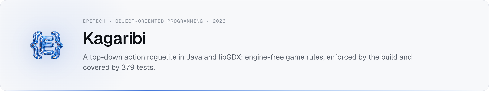
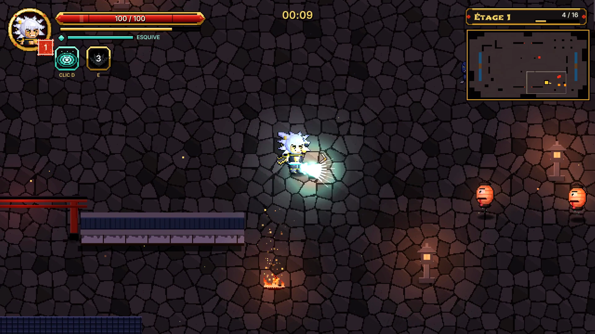
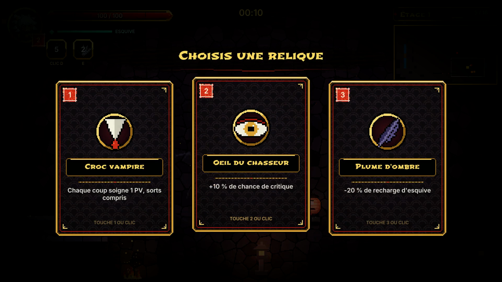
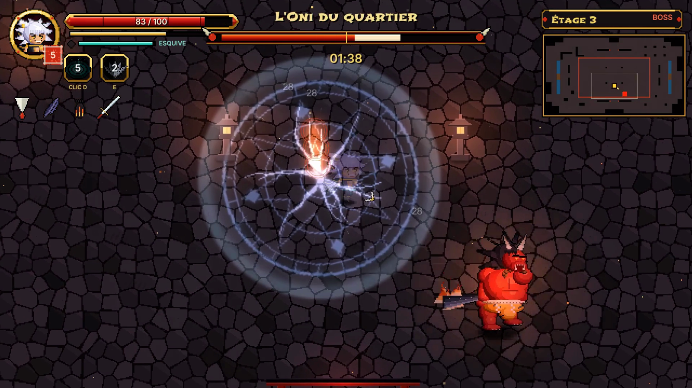

<picture><source media="(prefers-color-scheme: dark)" srcset="assets/banner-dark.png"></picture>

**Epitech Bachelor · Year 2 · Object-oriented programming (B-OOP-301) · Oct 2026**  
Source code is private under Epitech's academic policy. Happy to walk you through it or demo it live → **imran.nogueira@gmail.com**


| Combat | Relic choice | Boss |
|---|---|---|
|  |  |  |

The in-game interface is in French.

## Overview

A chibi hero crosses a burning Japanese district on a large map: two stages of enemy waves, a choice of one relic out of three at each level gained, then the district's Oni, a two-phase boss. It plays with keyboard and mouse or a gamepad, detected on the fly. The project's real subject is object-oriented design: the game rules are fully separated from rendering, and the build enforces that separation.

## Stack

| Layer | Tech |
|---|---|
| Language | Java 21 |
| Game framework | libGDX, LWJGL3 desktop backend |
| Build | Gradle, three modules |
| Tests | JUnit 6, JaCoCo coverage |
| Documentation | Javadoc, 10 PlantUML diagrams, game design document |

## How it works

```
lwjgl3   desktop launcher
  └─ core    screens, rendering, HUD, audio, input (libGDX)
       └─ model   all game rules, pure Java, no libGDX dependency
```

- **Each frame** — read input into a `PlayerIntent`, advance the model in fixed 1/60 s steps (at most 5 per frame), then draw.
- **One-way dependency** — the view sends intents and reads state. The model publishes `GameEvent`s and never knows the view exists.
- **State** — `Player` delegates to `IdleState`, `MovingState`, `AttackingState`, `DodgingState`, `HurtState` and `DeadState`. The boss swaps its `BossPhase` at 50% HP.
- **Strategy** — each enemy receives an `EnemyBehavior` (`ProwlerBehavior`, `ArcherBehavior`, `ChargerBehavior`).
- **Observer** — an `EventBus` dispatches events to sound, damage numbers and smoke effects in the view.
- **Factory** — `RelicFactory` is the only class that knows all 8 relics, and `EnemyFactory` turns wave data into enemies.
- **Template Method** — `Skill.tryActivate()` is `final` and handles the cooldown. `Shockwave` and `BladeFan` only write `activate()`.

## Key decisions

- **Separation enforced by the build, not by discipline** — `model` declares no libGDX dependency, so an `import com.badlogic…` there does not compile. The rules can then be tested without opening a window, at the cost of passing every player action through an intent object.
- **Fixed time step** — the simulation advances the same way whatever the screen's refresh rate. The cap of 5 steps per frame trades catching up after a long freeze for never spiralling.
- **Boss summons kept apart from its phases** — `BossSummons` lives outside `BossPhase`, so changing phase resets neither the summon timer nor the count of summoned enemies.
- **Tests as a gate** — a versioned `pre-push` hook runs the whole suite and refuses the push if a test fails.

## Results

- **Grade: 28/30**
- **379 tests passing** — 347 on the game rules (`model`) and 32 on input handling and the HUD timer (`core`)
- **Model coverage: 97.6% of lines, 90.8% of branches** (JaCoCo)
- **58 pull requests merged** over the project (Oct 2 – Oct 27, 2026)

## Contact

Code walkthrough or live demo on request → **imran.nogueira@gmail.com** · [Portfolio](https://imran-nogueira.github.io)
